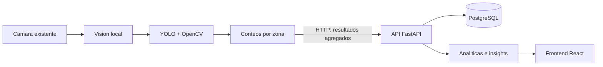

<p align="center">
  
</p>

<p align="center">
  <strong>Analítica visual para convertir el video de tu tienda en decisiones operativas.</strong>
</p>

<p align="center">
  <a href="https://retailo-web.onrender.com/#login">Abrir RetaiLO</a>
  ·
  <a href="https://retailo-api.onrender.com/docs">Explorar API</a>
  ·
  <a href="docs/adr/ADR_001_ESTRUCTURA_REPOSITORIO.md">Arquitectura</a>
</p>

<p align="center">
  <a href="https://retailo-web.onrender.com/#login"></a>
  <a href="https://retailo-api.onrender.com/docs"></a>
  <a href="docker-compose.yml"></a>
</p>

---

## Qué es RetaiLO

RetaiLO Analytics es una plataforma para tiendas de conveniencia pequeñas y medianas que transforma el video de sus cámaras existentes en información operativa. Detecta personas, mide actividad por zonas y relaciona el tráfico observado con ventas agregadas para encontrar oportunidades concretas dentro de la tienda.

La propuesta es sencilla: que una cámara deje de ser únicamente un dispositivo de grabación y se convierta en una fuente de datos. El procesamiento de visión ocurre localmente en el equipo del cliente; la API recibe resultados agregados y el panel los convierte en analíticas e insights accionables.

RetaiLO no identifica clientes, no usa reconocimiento facial y no asocia una compra con una persona. El sistema trabaja con patrones agregados por zona y periodo.

## Demo en línea

| Recurso | Enlace | Para qué sirve |
| --- | --- | --- |
| **Aplicación web** | [retailo-web.onrender.com](https://retailo-web.onrender.com/#login) | Registro, configuración de una tienda y dashboard analítico. |
| **API** | [retailo-api.onrender.com](https://retailo-api.onrender.com) | Servicio REST que centraliza autenticación, configuración y resultados. |
| **OpenAPI / Swagger** | [retailo-api.onrender.com/docs](https://retailo-api.onrender.com/docs) | Contrato interactivo de la API. |

La demo usa un video local incluido en el módulo Vision. El flujo actual permite configurar una tienda, asociar una cámara, dibujar zonas y consultar resultados agregados, tráfico, insights y recomendaciones.

## Cómo funciona



1. Vision consulta las zonas activas de una cámara.
2. Crea una sesión de procesamiento en la API.
3. YOLO procesa el video localmente y asigna las detecciones a polígonos configurados.
4. Vision publica únicamente métricas agregadas: frames, personas detectadas, visitas, permanencia y participación de tráfico por zona.
5. La API persiste el resultado, calcula analíticas y genera insights o recomendaciones.
6. El frontend presenta el estado de la tienda en un dashboard operativo.

El frontend nunca se comunica directamente con YOLO ni con Vision. La API es el punto central de integración y el contrato compartido entre los módulos.

## Capacidades del MVP

- Registro e inicio de sesión con sesiones Bearer.
- Alta, consulta, actualización y desactivación de tiendas.
- Administración de cámaras asociadas a cada tienda.
- Configuración de zonas poligonales por cámara.
- Procesamiento local de video con YOLO y OpenCV.
- Ejecución CPU-first, con aceleración CUDA opcional para desarrollo.
- Sesiones de procesamiento con estados `running`, `completed` y `failed`.
- Resultados agregados por sesión y zona.
- Tráfico, visitas, permanencia y participación por periodo.
- Insights como alto tráfico con bajas ventas y otras combinaciones de tráfico/ventas.
- Recomendaciones persistentes con estados `pending`, `accepted` y `rejected`.
- Simulación de ventas por zona sin datos personales.

## Arquitectura del repositorio

```text
retailo-analytics/
├── app/                    # API REST FastAPI y persistencia
│   ├── src/
│   │   ├── core/           # Base de datos y seguridad
│   │   ├── models/         # Modelos SQLAlchemy
│   │   ├── repos/          # Acceso a datos
│   │   ├── routers/        # Endpoints por dominio
│   │   ├── schemas/        # Contratos Pydantic
│   │   └── services/       # Lógica de negocio
│   └── Dockerfile
├── frontend/               # Aplicación React + Vite servida por nginx
├── vision/                 # Agente local YOLO/OpenCV
│   ├── src/
│   └── data/demo/          # Video de demostración
├── tests/                  # Pruebas de API y Vision
├── alembic/                # Migraciones de base de datos
├── docs/
│   ├── adr/                # Decisiones de arquitectura
│   └── agile/              # Backlog y Definition of Done
├── docker-compose.yml      # Entorno completo local
└── render.yaml             # Despliegue de API, web y PostgreSQL en Render
```

La separación entre `app`, `frontend` y `vision` mantiene independientes sus dependencias y ciclos de despliegue. En particular, la imagen pesada de YOLO no se mezcla con la API ni con nginx.

## API por dominios

La API organiza sus rutas alrededor del flujo operativo de una tienda:

| Dominio | Rutas principales |
| --- | --- |
| **Auth** | `/auth/register`, `/auth/login`, `/auth/me`, cambio de contraseña y cierre de sesión |
| **Stores** | `/stores` y `/stores/{store_id}` |
| **Cameras** | `/stores/{store_id}/cameras` y `/cameras/{camera_id}` |
| **Zones** | `/cameras/{camera_id}/zones` y `/zones/{zone_id}` |
| **Sessions** | `/cameras/{camera_id}/sessions` y `/sessions/{session_id}` |
| **Results** | `/sessions/{session_id}/video-results` |
| **Analytics** | `/stores/{store_id}/analytics/summary`, `/traffic` e `/insights` |
| **Sales** | Carga y consulta de ventas agregadas por zona |
| **Recommendations** | Generación, consulta y actualización de recomendaciones |
| **Health** | `/health` para disponibilidad y conectividad |

La documentación interactiva se genera automáticamente con FastAPI en `/docs`; la raíz `/` redirige a ella.

## Ejecutar localmente

### Requisitos

- Docker y Docker Compose
- Python 3.12 para desarrollo y pruebas sin contenedores
- Node.js 18+ y npm para trabajar directamente en el frontend

### Entorno completo con Docker

```bash
cp .env.example .env
docker compose up --build
```

Después de iniciar los servicios:

- Aplicación web: <http://localhost:3000>
- API: <http://localhost:8000>
- Swagger: <http://localhost:8000/docs>
- Health check: <http://localhost:8000/health>

El servicio `vision` está detrás del perfil `edge`, para que la API y el frontend puedan levantarse sin ejecutar inferencia automáticamente. Para incluirlo:

```bash
docker compose --profile edge up --build
```

### Desarrollo de la API

```bash
python -m venv .venv
source .venv/bin/activate
pip install -r requirements.txt
pip install -r app/requirements.txt
cp .env.example .env
uvicorn app.src.main:app --reload --port 8000
```

La configuración se controla mediante variables de entorno. No uses credenciales reales en `.env` ni las subas al repositorio.

### Desarrollo del frontend

```bash
cd frontend
npm install
npm run dev
```

El frontend consume la API mediante rutas relativas bajo `/api`. En producción, nginx reenvía esas rutas al servicio API; esta configuración también permite mantener el navegador desacoplado del host interno de Docker.

### Ejecutar Vision

Con la API disponible y el modelo `yolov8n.pt` en la raíz del repositorio:

```bash
API_BASE_URL=http://localhost:8000 \
DEMO_VIDEO_PATH=vision/data/demo/supermarket.mp4 \
CAMERA_ID=1 \
MODEL_PATH=yolov8n.pt \
python -m vision.src.main
```

En Docker Compose, Vision usa por defecto `http://api:8000` y el video de `vision/data/demo/supermarket.mp4`.

## Pruebas y calidad

Instala las dependencias de desarrollo y ejecuta la suite desde la raíz:

```bash
pip install -r requirements.txt
pytest
ruff check app vision tests
mypy
```

La configuración de pytest exige una cobertura global mínima del 80 %. Las pruebas cubren autenticación, cámaras, tiendas, sesiones, analíticas, contratos de esquemas, cliente de Vision y flujo MVP.

## Privacidad y límites actuales

- El sistema procesa conteos y métricas agregadas, no identidades.
- No hay reconocimiento facial ni seguimiento de compras por persona.
- La API no almacena imágenes ni video del cliente como parte del flujo MVP.
- Vision procesa localmente y envía resultados resumidos mediante HTTP.
- Las fuentes de video reales, como webcam o RTSP, son una evolución del video demo actual.
- El rendimiento y la precisión dependen de la posición de la cámara, la calidad del video y la configuración de zonas.
- La integración de un modelo de machine learning para recomendaciones todavía no tiene un contrato técnico definido.

## Documentación del proyecto

- [Estructura y arquitectura modular](docs/adr/ADR_001_ESTRUCTURA_REPOSITORIO.md)
- [Contrato de la API](docs/adr/ADR_004_API_CONTRACT.md)
- [Endpoints por dominio](docs/adr/ADR_002_ENDPOINTS.md)
- [Estructura modular](docs/adr/ADR_001_ESTRUCTURA_REPOSITORIO.md)
- [Docker y dependencias por módulo](docs/adr/ADR_003_WORKFLOW.md)
- [Backlog y user stories](docs/agile/BACKLOG.md)
- [Definition of Done](docs/agile/DEFINITION_OF_DONE.md)

## Flujo de contribución

1. Consulta el [backlog](docs/agile/BACKLOG.md) y define el alcance de la tarea.
2. Crea una rama desde `dev` con el formato `feature/<nombre>`.
3. Mantén el contrato entre API, frontend y Vision actualizado.
4. Agrega o actualiza pruebas y documentación cuando cambie el comportamiento.
5. Ejecuta la Definition of Done antes de abrir un Pull Request hacia `dev`.

Las decisiones técnicas relevantes se registran como ADR para conservar el contexto del proyecto.

## Equipo

RetaiLO Analytics fue construido para ayudar a negocios locales a aprovechar la infraestructura de cámaras que ya tienen, con una arquitectura que puede crecer desde una demo reproducible hacia procesamiento en el borde y analítica operativa de producción.

<p align="center">
  <strong>RetaiLO Analytics</strong><br>
  <em>Del video de tu tienda a decisiones más claras.</em>
</p>
